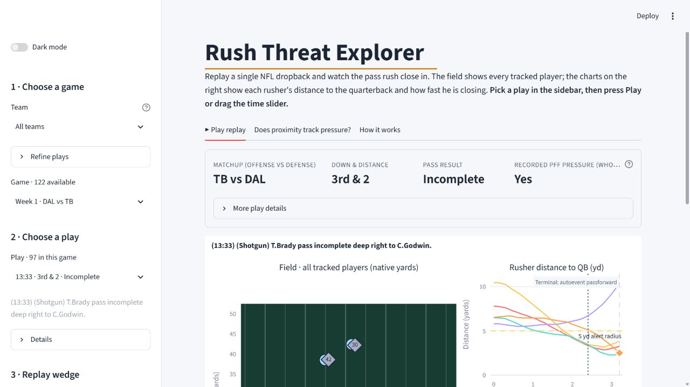
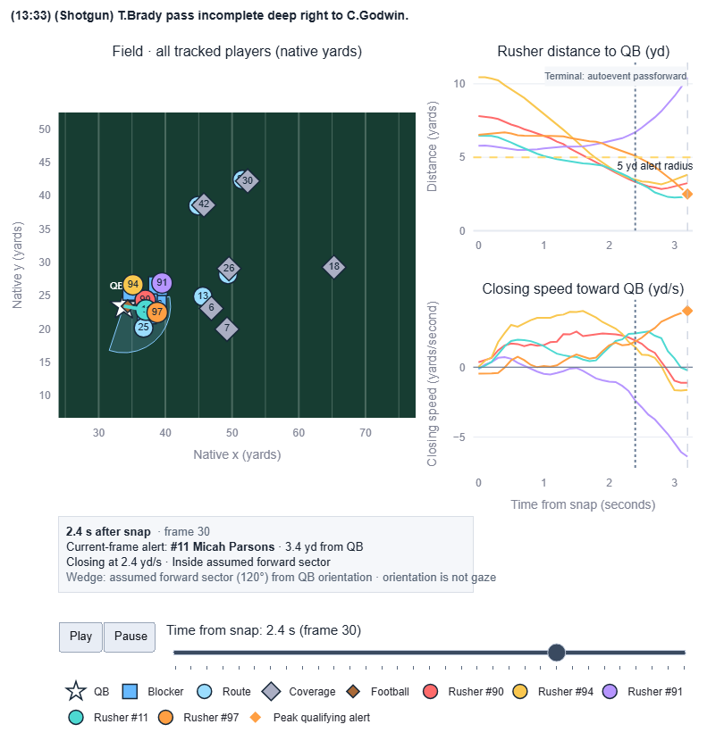
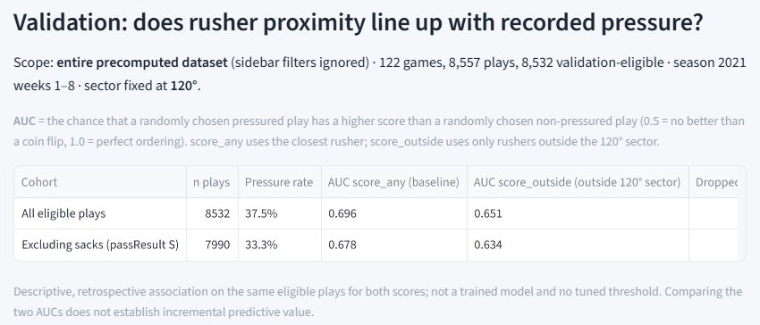
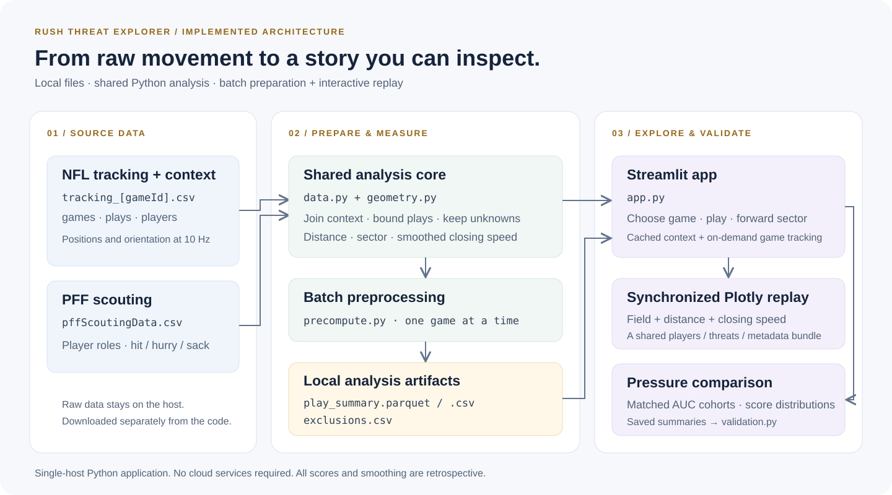

<div align="center">

# Rush Threat Explorer

### See the pass rush. Follow the threat. Check the evidence.

An interactive NFL analytics app that turns player tracking data into a synchronized replay of the pressure around a quarterback.

**Python · Streamlit · Plotly · pandas · NumPy · pytest**

[Product tour](#product-tour) · [Architecture](#architecture) · [Findings](#what-the-data-shows) · [Run locally](#run-locally) · [Engineering guide](docs/ARCHITECTURE.md)

</div>



*Actual app, real tracking data: Tampa Bay vs Dallas, Week 1 of 2021. All product screenshots use light mode.*

## The idea in 30 seconds

A sack tells you how a play ended. Tracking data can show **how the threat developed**: which defender approached, how quickly the gap closed, and where that defender was relative to the quarterback's orientation.

Rush Threat Explorer brings that sequence onto one screen. Pick a play, scrub through the dropback, and follow each rusher from the field to the charts. Then open the analysis tab to see whether simple proximity measures line up with recorded pressure.

| Explore | What you get |
| :--- | :--- |
| **Replay a dropback** | Every tracked player, a quarterback orientation wedge, and a shared timeline. |
| **Follow individual rushers** | Matching colors across the field, distance chart, and closing-speed chart. |
| **Investigate a threat** | A frame-level alert for the fastest approaching rusher within five yards. |
| **Check the evidence** | Pressure comparisons, score distributions, a sack-excluded cohort, and explicit data exclusions. |

**Dataset scope:** 2021 regular season, Weeks 1–8 · **122 games** · **8,557 plays** · **8,532 validation-eligible plays** in the full local preprocessing run. A two-game demo works too; the app labels partial coverage.

## Product tour

### 1. Pick a play and follow the rush

Use the sidebar to choose a team, game, and play. Optional filters narrow the list by recorded pressure or pass result. The context card keeps the matchup, down and distance, and outcome visible.



*Replay exported directly from the running app at 2.4 seconds after the snap.*

**How to read it:** the star is the quarterback; each colored rusher keeps the same color in both charts. Falling distance means the gap is shrinking. Positive closing speed means the rusher is approaching. The wedge is an assumed forward sector based on player orientation.

### 2. Move through time, then ask a question

Press **Play** or drag the replay slider. The field, chart cursors, and current threat alert move together. Adjust the forward sector between **60° and 180°** to inspect the play from different geometric assumptions.

**A useful first demo:** choose **Week 1 · DAL vs TB**, then **13:33 · 3rd & 2 · Incomplete** (game `2021090900`, play `97`). Scrub to **2.4 seconds after the snap** and follow Micah Parsons, **#11**, as he closes on Tom Brady. Open **Does proximity track pressure?** to move from an individual play to the dataset-level comparison.

The wedge changes the replay; the analysis always uses a fixed **120°** sector so the comparison stays consistent. Player orientation is a geometric reference, not a measurement of where the quarterback is looking.

### 3. Check whether the visual story holds up



The analysis uses the entire precomputed dataset, independent of sidebar filters. It compares two scores on the **same eligible plays** and repeats the comparison without sacks.

## Architecture



The app separates **batch preparation** from **interactive exploration**:

1. **Prepare once.** `precompute.py` processes one game's tracking file at a time, joins play context and PFF roles, computes proximity scores, and writes a summary plus an exclusion report.
2. **Load what the user needs.** Streamlit caches context and summaries. Tracking is loaded per selected game, with a cache limited to two games.
3. **Build a shared play bundle.** The data layer produces player positions, per-rusher measurements, and play metadata. Plotly turns that bundle into synchronized animated views.
4. **Compare transparently.** The validation module computes rank-based AUC, matched cohorts, and exclusion counts from the saved summaries.

This implementation runs as a **local Python application**. No cloud account or AWS services are required. See the [engineering guide](docs/ARCHITECTURE.md) for the component diagram, data contracts, and extension points.

## What the data shows

Results below were recomputed from the full local preprocessing output. **AUC** measures how often a pressured play receives a higher score than a non-pressured play: 0.5 is chance ordering; 1.0 is perfect ordering.

| Cohort | Plays | Recorded pressure | Closest-rusher AUC | Outside-sector AUC |
| :--- | ---: | ---: | ---: | ---: |
| All eligible plays | 8,532 | 37.5% | **0.696** | 0.651 |
| Excluding sacks | 7,990 | 33.3% | **0.678** | 0.634 |

**Takeaway:** simple rusher proximity is associated with recorded pressure in this dataset. Restricting the score to rushers outside the forward sector gives a lower AUC in both cohorts. These results support a useful exploratory tool; they do not establish a predictive advantage for the orientation-based score.

<details>
<summary><strong>Measurement details and limitations</strong></summary>

- **Recorded pressure:** any defender credited by PFF with a hit, hurry, or sack; counted once per play. This label does not identify the moment pressure began.
- **Validation window:** snap through the earlier of snap + 25 frames or one frame before the first release, sack, or scramble event. Tracking is sampled at 10 frames per second.
- **Closest-rusher score:** `1 / (1 + minimum distance in yards)` within the validation window.
- **Outside-sector score:** the same calculation using only observations outside the fixed 120° sector. It is zero when orientation is valid but no rusher is outside; missing orientation remains unknown.
- **Replay alert:** the rusher within five yards with the highest positive closing speed. Speed uses actual frame gaps and a centered three-sample smoothing window.
- **Limits:** all calculations are retrospective, including the smoothing. There is no trained model, held-out evaluation, or live prediction. Sacks, unequal observation lengths, quarterback movement, and initial scouting roles affect interpretation.
- **Data quality:** 25 plays are excluded from the full validation cohort. Reasons can overlap; excluded plays remain selectable where replay data is available.

</details>

## Engineering decisions worth a closer look

| Decision | Why it matters | Read the code |
| :--- | :--- | :--- |
| Separate preprocessing and UI | Dataset-wide work happens before interaction; game tracking loads on demand. | [Preprocessing](precompute.py), [app caching](app.py) |
| Pure geometry functions | Distance, wrapped angles, and frame-gap-aware speed can be checked independently of the UI. | [Geometry](rush_threat/geometry.py) |
| A shared replay bundle | Rendering consumes an explicit players/threats/metadata contract. | [Data layer](rush_threat/data.py), [renderer](rush_threat/figure.py) |
| Explicit missing-data behavior | Missing orientation stays unknown; absent players clear between frames; chart gaps stay visible. | [Geometry](rush_threat/geometry.py), [renderer](rush_threat/figure.py) |
| Matched validation cohorts | Both scores are compared on the same plays, with a separate comparison excluding sacks. | [Validation](rush_threat/validation.py) |
| Reproducible checks | Synthetic edge cases work without the dataset; real-data integration checks exercise the replay and app. | [Tests](tests/) |

## Run locally

**You need Python 3.13 and a separate copy of the NFL Big Data Bowl tracking dataset.** Raw data and generated summaries are excluded from Git. Use the repository root for the commands below.

### 1. Install

```powershell
git clone https://github.com/Infosuii/AWS-hackathon.git
cd AWS-hackathon
python -m venv .venv
.\.venv\Scripts\python.exe -m pip install -r requirements.txt
```

### 2. Add the data

Place the extracted files in `data/`:

```text
data/
├── games.csv
├── plays.csv
├── players.csv
├── pffScoutingData.csv
└── tracking/
    ├── tracking_2021090900.csv
    └── ...
```

The app also recognizes `nfl-big-data-bowl-regional-event-data-main/data/`. To use another location, set `$env:RUSH_DATA_DIR = "C:\path\to\data"` to the folder containing these files.

### 3. Prepare a demo and launch

Run in the same PowerShell session:

```powershell
$env:RUSH_DATA_DIR = (Resolve-Path ".\data").Path
$env:RUSH_ARTIFACT_DIR = "artifacts"

# Two games are enough to explore the product.
.\.venv\Scripts\python.exe precompute.py --games 2 --data-dir "$env:RUSH_DATA_DIR" --output-dir "$env:RUSH_ARTIFACT_DIR"
.\.venv\Scripts\python.exe -m streamlit run app.py
```

Open **[localhost:8501](http://localhost:8501)**. Switch **Dark mode** off for the appearance shown above. Replace `--games 2` with `--games all` to reproduce the full-dataset analysis. Keep the terminal open while using the app.

<details>
<summary><strong>macOS / Linux commands</strong></summary>

After cloning the repository and adding the dataset:

```bash
python3.13 -m venv .venv
source .venv/bin/activate
python -m pip install -r requirements.txt
export RUSH_DATA_DIR="$PWD/data"
export RUSH_ARTIFACT_DIR="$PWD/artifacts"
python precompute.py --games 2 --data-dir "$RUSH_DATA_DIR" --output-dir "$RUSH_ARTIFACT_DIR"
python -m streamlit run app.py
```

</details>

<details>
<summary><strong>Troubleshooting</strong></summary>

| Symptom | Fix |
| :--- | :--- |
| “No preprocessing output found” | Run `precompute.py` first. `RUSH_ARTIFACT_DIR` must point to its output folder. |
| “Replay unavailable” | Check `RUSH_DATA_DIR` and the selected game's tracking CSV. Summaries alone cannot render tracking. |
| “Partial data” | Expected with `--games 2`; use `--games all` for the full cohort. |
| Parquet support unavailable | Omit `pyarrow` during installation and use `--format csv`; the app can read CSV summaries. |

Additional environment notes are in [submission/SETUP.md](submission/SETUP.md).

</details>

## Verify it

```powershell
.\.venv\Scripts\python.exe -m pytest tests -q -ra
```

The suite covers geometry, play windows, missing data, preprocessing, animation consistency, pressure comparisons, and Streamlit app wiring. Real-data checks run when `RUSH_DATA_DIR` is set; the real app check also needs `RUSH_ARTIFACT_DIR`.

## Navigate the repository

```text
app.py                    Streamlit interface, filters, tabs, and caching
precompute.py             Batch preparation and exclusion reports
rush_threat/
├── data.py               Data joins, play windows, replay bundles, summaries
├── geometry.py           Distances, bearings, sectors, closing speed
├── figure.py             Synchronized Plotly replay and charts
└── validation.py         Pressure cohorts, AUC, and data-quality summaries
tests/                    Unit, rendering, preprocessing, and integration checks
docs/
├── ARCHITECTURE.md        Engineering walkthrough
└── images/               Real light-mode screenshots and architecture diagram
submission/SETUP.md       Additional setup notes
```

**Data credits:** player tracking from NFL Next Gen Stats; scouting roles and pressure labels from Pro Football Focus, distributed with the NFL Big Data Bowl regional event dataset. The included [data dictionary](nfl-big-data-bowl-regional-event-data-main/README.md) documents the source fields and join keys.
