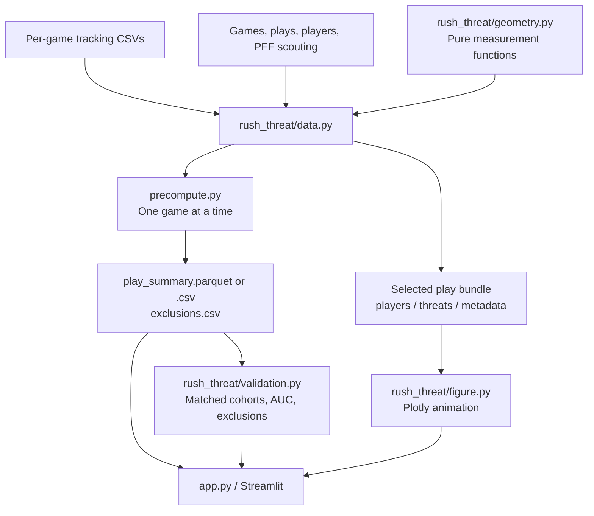

# Engineering walkthrough

[← Back to the product overview](../README.md)

Rush Threat Explorer has two execution paths: a batch job prepares dataset-wide summaries; an interactive app rebuilds the selected play from tracking data. Both paths share the same data and geometry code.


## Components and dependencies



### Data and geometry

[`data.py`](../rush_threat/data.py) joins game, play, and player context with PFF scouting. It identifies the quarterback and initial pass-rush roles, locates the snap and terminal event, and builds either per-play replay bundles or per-game summary rows.

[`geometry.py`](../rush_threat/geometry.py) contains pure functions for distance, bearing, wrapped angular difference, sector membership, closing speed, and smoothing. Its coordinate convention matches the source: 0° points along +y, 90° along +x, increasing clockwise. Field coordinates stay in native yards.

At 10 Hz, closing speed is `−Δdistance / (ΔframeId / 10)`. Using actual frame differences prevents a missing sample from appearing as an artificial speed spike. Centered three-sample smoothing makes this a retrospective measure.

### Batch preparation

[`precompute.py`](../precompute.py) loads context once and processes tracking files in sorted game order. Each processed game's plays remain in the output, including ineligible plays. Failures produce excluded placeholder rows and a nonzero process exit code rather than silently disappearing from the cohort.

| Artifact | Purpose |
| :--- | :--- |
| `play_summary.parquet` or `play_summary.csv` | One row per `(gameId, playId)`: context, pressure label, replay availability, validation eligibility, distances, scores, and peak-alert metadata. |
| `exclusions.csv` | Totals and counts for explicit exclusion reasons. A play can have multiple reasons. |

Parquet is preferred when `pyarrow` is installed; CSV is supported as a fallback. Both artifacts and raw data are excluded from version control.

### Interactive app

[`app.py`](../app.py) uses Streamlit's data cache for normalized summaries and resource caches for context and game tracking. Tracking cache capacity is two games. Filtering operates on summary rows; selecting a play triggers a bundle build for that game and play.

| Bundle member | Contents | Consumer |
| :--- | :--- | :--- |
| `players` | Frame, player identity, position, orientation, jersey, role, time from snap | Field rendering |
| `threats` | Rusher position, QB-relative distance and bearing, sector status, closing speed, validation-window flag | Field alerts and timelines |
| `metadata` | Play context, boundaries, sector angle, availability, eligibility, and reasons | Context card and figure |

[`figure.py`](../rush_threat/figure.py) builds the field and two linked charts. A stable trace map ensures each animation frame updates the intended players, wedge, alert, and cursors. Missing entities are cleared; absent samples become visible timeline gaps. Rusher colors stay consistent across views. The renderer accepts `dark=False` for readable light-mode labels and panels.

### Validation

[`validation.py`](../rush_threat/validation.py) normalizes saved data, explicitly parses nullable booleans, and computes an average-rank AUC with tied scores handled consistently.

The cohort must have a known pressure label, validation eligibility, and finite values for both scores. The comparison then repeats with sacks removed. This keeps the two scores on the same rows within each cohort.

The replay sector is adjustable; dataset-level summaries always use 120°. Sidebar filters do not change the validation cohort. The interface reports processed coverage and warns when it is less than the full 122 games.

## Boundary and missing-data rules

- The validation window ends at `min(snap + 25, terminal − 1)` frames.
- The terminal event is the earliest recognized pass release, sack, or scramble after the snap.
- Missing orientation or undefined bearing stays unknown rather than becoming “inside.”
- Unknown boundaries can allow a flagged fallback replay while excluding the play from validation.
- A rusher must be within five yards and have finite positive closing speed to qualify for a frame alert. Equal speeds are resolved by numeric player ID.
- The alert does not require the rusher to be outside the sector; sector membership is descriptive.

## Reproduce the analysis

From the repository root, with dependencies installed and `RUSH_DATA_DIR` set:

```powershell
$env:RUSH_ARTIFACT_DIR = "artifacts"
.\.venv\Scripts\python.exe precompute.py --games all --data-dir "$env:RUSH_DATA_DIR" --output-dir "$env:RUSH_ARTIFACT_DIR"
.\.venv\Scripts\python.exe -m pytest tests -q -ra
.\.venv\Scripts\python.exe -m streamlit run app.py
```

The README's results come from 122 games, 8,557 summary rows, and 8,532 eligible plays. Recompute them from your generated artifacts; do not assume a two-game demo has the same metrics.

## Where to extend it

These are potential next steps, not implemented features:

- **Predictive evaluation:** define a future pressure target, use causal feature windows, and hold out games before making predictive claims.
- **More pressure context:** add blocker-rusher relationships and quarterback movement features, with explicit checks for their extra value.
- **Hosted access:** deploy the Streamlit app with a data-access plan appropriate to the dataset's distribution terms.
- **Broader coverage:** adapt the loader to additional seasons and validate schema and event-name differences.

## Screenshot provenance

The README's interface screenshots are browser captures of the root `app.py` running with real local data, the full preprocessing output, and light mode selected. The detailed replay image is exported through the app's own Plotly download control at 2.4 seconds after the snap: game `2021090900`, play `97`. The architecture illustration describes the implemented local system; it is maintained as an editable SVG.
